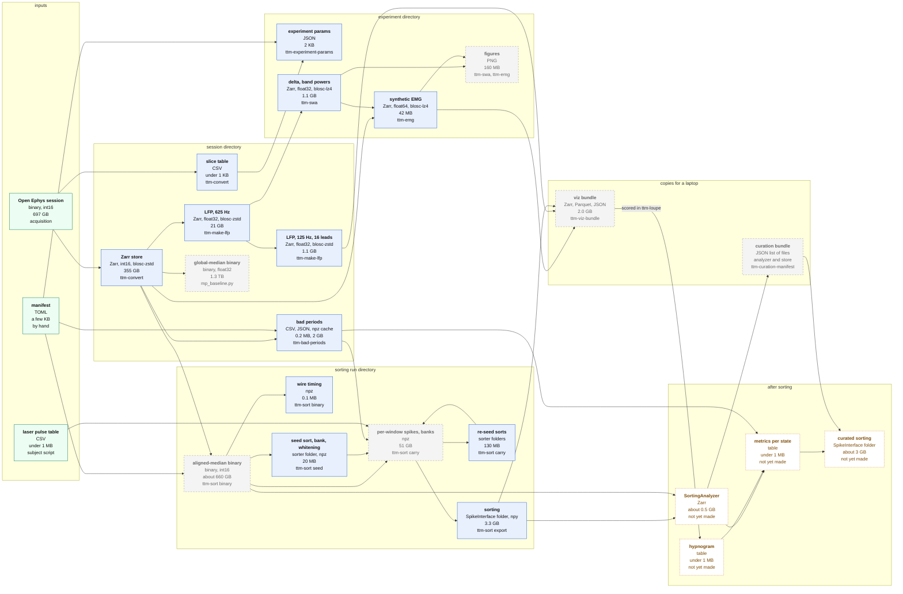

# Data products

Every product of one 48 h recording, what makes it, what it is made
from, and its size. Sizes are TTM-003-48H's (64 channels, 30 kHz, 48 h).
`<session>` is `<data_root>/<session>/`, `<experiment>` is
`<data_root>/<subject>/<experiment>/`, `<run>` is
`<session>/sortings_carry/<run>/`. Steps and parameters of the sort are
in [`sorting_pipeline.md`](sorting_pipeline.md); the commands in
[`pipeline.md`](pipeline.md).

Every box has four lines, always in this order:

1. what the product is;
2. its format and sample type;
3. its size for TTM-003-48H;
4. what makes it.

Solid boxes are kept. Dashed grey boxes can be regenerated from their
inputs and may be deleted once nothing in use reads them. Dotted boxes
do not exist yet. An arrow points from an input to what is made from it.

## Products

| Product | Path | Format | Made by | From | Size | Kept |
|---|---|---|---|---|---|---|
| Open Ephys session | archive `SUBJECT/<session>/` | binary, int16 (0.195 uV per bit) | acquisition |  | 697 GB | yes, the original |
| Manifest | `subjects/<id>/experiments/<NAME>.toml` | TOML | by hand |  | a few KB | yes, in git |
| Laser pulse table | `subjects/<id>/results/` | CSV | subject script (TTM-003: `laser_pulses.py`) | session TTL events | under 1 MB | yes, in git |
| Zarr store | `<session>/<session>.blosc-zstd.zarr` | Zarr, int16, blosc-zstd (lossless) | `ttm-convert` | session | 355 GB | yes; every product below starts here |
| Slice table | `<session>/slice_table.csv` | CSV | `ttm-convert` | session | under 1 KB | yes |
| Experiment params | `<experiment>/experiment_params.json` | JSON | `ttm-experiment-params` | manifest, slice table | 2 KB | yes; rewritten when the manifest changes |
| LFP, 625 Hz | `<session>/<session>.lfp.zarr` | Zarr, float32 (uV), blosc-zstd | `ttm-make-lfp` | store | 21 GB | yes |
| LFP, 125 Hz, 16 leads | `<session>/<session>.lfp.125hz.zarr` | Zarr, float32 (uV), blosc-zstd | `ttm-make-lfp --subsample 125` | 625 Hz LFP | 1.1 GB | yes |
| Delta, band powers | `<experiment>/delta.idelta.zarr`, `stft_bandpowers.zarr` | Zarr, float32, blosc-lz4 | `ttm-swa all` | 625 Hz LFP | 1.1 GB, 29 MB | yes |
| Synthetic EMG | `<experiment>/synthetic_emg_methods.zarr` | Zarr, float64, blosc-lz4 | `ttm-emg --full` | store, slice table, delta | 42 MB | yes |
| Figures | `<experiment>/figures/` | PNG | `ttm-swa plot`, `ttm-emg` | the above | 160 MB | regenerable |
| Bad periods | `<session>/bad_periods/` | CSV table; JSON of its input and thresholds; npz cache of the scan | `ttm-bad-periods` | store (aligned median, lazily), manifest; or a binary | 0.2 MB table, 2 GB cache | the table yes; the cache only to rerun thresholds |
| Global-median binary | `<session>/sortings_seed42_pcafix/mp_baseline/binary/` | binary, float32 (ADC counts) | `mp_baseline.py` | store | 1.3 TB | only while sortings made on it are in use; the pipeline no longer reads it |
| Aligned-median binary | `<run>/binary/` | binary, int16 (ADC counts, rounded) | `ttm-sort binary` | store, manifest | about 660 GB | while its sorting is analysed or curated; 40 min to rewrite |
| Wire timing | `<run>/wire_timing.npz` | npz, float64 | `ttm-sort binary` | store | 0.1 MB | yes; the binary is reproducible from it |
| Seed sort, bank, whitening | `<run>/seed_sort/`, `bank0.npz`, `whitening.npz` | MountainSort5 folder; npz, float32 | `ttm-sort seed` | binary | 20 MB | yes |
| Per-window spikes and banks | `<run>/carry/` | npz | `ttm-sort carry` | binary, bank, bad periods, pulses | 51 GB | until the sorting is final; resume and re-export read it |
| Re-seed sorts | `<run>/reseed_sorts/` | MountainSort5 folders | `ttm-sort carry` | binary | 130 MB | yes |
| Sorting | `<run>/sorting/` | SpikeInterface folder (npy) | `ttm-sort export` | per-window spikes | 3.3 GB | yes |
| Viz bundle | `<session>/viz_bundle/` | Zarr, Parquet, JSON | `ttm-viz-bundle` | EMG, 125 Hz LFP, a sorting | 2.0 GB | regenerable |
| Investigation products | `<session>/sortings_seed42_pcafix/` (hybrids, arms, the first 6 h binaries, earlier sorts) | various | `investigations/` |  | 1.1 TB besides the two 48 h float32 binaries (global and aligned median, `mp_baseline/` and `mp_aligned/`, 1.3 TB each) | until the user decides |

Not yet produced: the SortingAnalyzer of the new sorting (built on the
binary it was sorted from; June production's was 0.5 GB), the hypnogram
(scored in `ttm-loupe`), quality metrics per vigilance state, and the
curated sorting.
