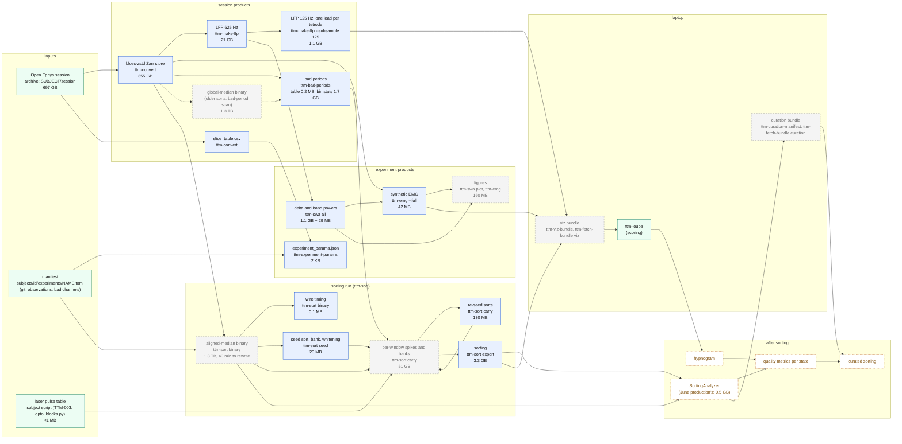

# Data products

Every product of one 48 h recording, what makes it, what it is made
from, and its size. Sizes are TTM-003-48H's (64 channels, 30 kHz, 48 h).
`<session>` is `<data_root>/<session>/`, `<experiment>` is
`<data_root>/<subject>/<experiment>/`, `<run>` is
`<session>/sortings_carry/<run>/`. Steps and parameters of the sort are
in [`sorting_pipeline.md`](sorting_pipeline.md); the commands in
[`pipeline.md`](pipeline.md).

Solid boxes are kept. Dashed grey boxes can be regenerated from what
they were made from and may be deleted once nothing in use reads them.
Dotted boxes do not exist yet.

## Products

| Product | Path | Made by | From | Size | Kept |
|---|---|---|---|---|---|
| Open Ephys session | archive `SUBJECT/<session>/` | acquisition | | 697 GB | yes, the original |
| Manifest | `subjects/<id>/experiments/<NAME>.toml` | by hand | | KB | yes, in git |
| Zarr store | `<session>/<session>.blosc-zstd.zarr` | `ttm-convert` | session | 355 GB | yes; every product below starts here |
| Slice table | `<session>/slice_table.csv` | `ttm-convert` | session | KB | yes |
| Experiment params | `<experiment>/experiment_params.json` | `ttm-experiment-params` | manifest, slice table | 2 KB | yes; rewritten when the manifest changes |
| LFP 625 Hz | `<session>/<session>.lfp.zarr` | `ttm-make-lfp` | store | 21 GB | yes |
| LFP 125 Hz | `<session>/<session>.lfp.125hz.zarr` | `ttm-make-lfp --subsample 125` | 625 Hz LFP | 1.1 GB | yes |
| Delta, band powers | `<experiment>/delta.idelta.zarr`, `stft_bandpowers.zarr` | `ttm-swa all` | 625 Hz LFP | 1.1 GB, 29 MB | yes |
| Synthetic EMG | `<experiment>/synthetic_emg_methods.zarr` | `ttm-emg --full` | store, slice table, delta | 42 MB | yes |
| Figures | `<experiment>/figures/` | `ttm-swa plot`, `ttm-emg` | the above | 160 MB | regenerable |
| Bad periods | `<session>/bad_periods/` | `ttm-bad-periods` | store (global median, lazily) or a binary | 2 GB, of which the table 0.2 MB | the table yes; `bin_stats_0p1s.npz` (1.7 GB) is a cache of the scan |
| Global-median binary | `<session>/sortings_seed42_pcafix/mp_baseline/binary/` | `mp_baseline.py` | store | 1.3 TB | only while sortings made on it are in use |
| Aligned-median binary | `<run>/binary/` (TTM-003: `sortings_seed42_pcafix/mp_aligned/binary/`) | `ttm-sort binary` | store, manifest | 1.3 TB | while its sorting is analysed or curated; 40 min to rewrite |
| Wire timing | `<run>/wire_timing.npz` | `ttm-sort binary` | store | 0.1 MB | yes; the binary is reproducible from it |
| Seed sort, bank, whitening | `<run>/seed_sort/`, `bank0.npz`, `whitening.npz` | `ttm-sort seed` | binary | 20 MB | yes |
| Per-window spikes and banks | `<run>/carry/` | `ttm-sort carry` | binary, bank, bad periods, pulses | 51 GB | until the sorting is final; resume and re-export read it |
| Re-seed sorts | `<run>/reseed_sorts/` | `ttm-sort carry` | binary | 130 MB | yes |
| Sorting | `<run>/sorting/` | `ttm-sort export` | per-window spikes | 3.3 GB | yes |
| Viz bundle | `<session>/viz_bundle/` | `ttm-viz-bundle` | EMG, 125 Hz LFP, a sorting | see below | regenerable |
| Investigation products | `<session>/sortings_seed42_pcafix/` (hybrids, arms, the first 6 h binaries, earlier sorts) | `investigations/` | | 1.1 TB besides the two 48 h binaries | until the user decides |

Not yet produced: the SortingAnalyzer of the new sorting (built on the
binary it was sorted from; June production's was 0.5 GB), the hypnogram
(scored in `ttm-loupe`), quality metrics per vigilance state, and the
curated sorting.
